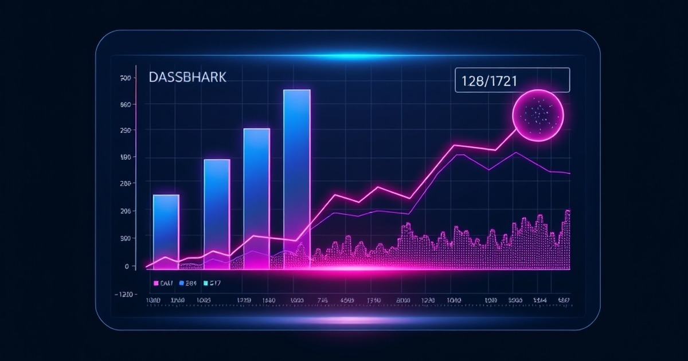

# Antigravity Zero-Token Suite

[](https://github.com/Amz34/antigravity-zero-token-suite/actions/workflows/ci.yml)

Local-first workspace scanner and context-budget guardrail that flags oversized source files before an autonomous coding agent ingests them into its prompt window.



## Why It Exists

Unbounded file reads are one of the fastest ways for autonomous coding loops to exhaust API token quotas. When an agent reads an entire log, lockfile, or monolithic module in a single turn, every subsequent step in that conversation pays the context overhead.

`antigravity-zero-token-suite` pairs a dependency-free Python CLI scanner (`scripts/token_guard.py`) with a declarative policy (`config/antigravity_rules.md`) so local scripts pre-screen the repository at zero API cost and tell the agent which files require targeted line-range reads.

## Features

- **Zero External Dependencies:** Built purely on the Python 3 standard library (`argparse`, `json`, `os`, `pathlib`).
- **Heuristic Token Budgeting:** Computes per-file and workspace-wide line, character, and estimated token counts (`chars // 4` by default).
- **Oversized File Detection:** Flags any source or documentation file exceeding the configurable `--max-lines` threshold (default `150` lines).
- **CI Gate Mode (`--strict`):** Returns exit code `1` when oversized files are detected, or emits structured JSON (`--json`) for downstream agent consumption.
- **Automatic Directory Pruning:** Skips `.git`, `node_modules`, `__pycache__`, `.venv`, `dist`, and `build` trees automatically.

## Quickstart

Clone the repository and run the scanner against any project directory:

```bash
git clone https://github.com/Amz34/antigravity-zero-token-suite.git
cd antigravity-zero-token-suite

# Human-readable workspace report
python3 scripts/token_guard.py .

# Machine-readable JSON output with a custom 120-line threshold
python3 scripts/token_guard.py . --max-lines 120 --json
```

Example output:

```text
=== Antigravity Zero-Token Workspace Scanner ===
Scanned Root:              /workspace/project
Total Eligible Files:      4
Total Lines of Code/Text:  224
Estimated Full-Read Cost:  ~1890 tokens

[ALERT] Files exceeding 150 lines (use targeted line ranges instead of full reads):
  - scripts/token_guard.py: 152 lines (~1210 tokens)
```

## Context-Guard Policy (`config/antigravity_rules.md`)

| Rule | Operational Constraint |
|---|---|
| Targeted Reads Only | Avoid reading files larger than 150 lines in one turn; use line offsets or `grep`/`sed`. |
| Local Offload First | Execute parsing, regex filtering, and JSON aggregation in local Python/shell scripts before calling an LLM. |
| Subagent Economy | Pass concise, self-contained task payloads to child workers rather than full conversation histories. |
| Explicit Routing | Restrict MCP and model calls to approved endpoints configured for the workspace. |

## Running Tests

```bash
python3 -m unittest discover -s tests -v
```

## Limitations

- Token counts use a deterministic character-division heuristic (`chars // 4`) rather than a model-specific BPE tokenizer so the scanner runs with zero third-party packages.
- Binary files and extensions outside the default source/documentation set are skipped.

## License

Released under the [MIT License](LICENSE).

<!-- agent-infra-backlink -->
---

<sub>Part of the **[Awesome Agent Infrastructure](https://Amz34.github.io/awesome-agent-infrastructure/)** collection — 135 live-verified agent tools across 9 categories ([repo](https://github.com/Amz34/awesome-agent-infrastructure) · [profile](https://github.com/Amz34)).</sub>
<!-- /agent-infra-backlink -->
